# MySQL 底层原理可视化指南 · MVCC 与事务锁

写给零基础小白：从事务基础出发，一步步看懂 MVCC 多版本并发控制、InnoDB 锁体系，以及两者如何配合解决并发问题；最后专门讲清数据如何落盘、undo/redo/binlog 如何配合、宕机后怎样崩溃恢复。每个概念都有类比、图解、SQL 例子和小结。

## 页签一 · 事务基础铺垫

*本页回答：事务是什么？为什么会出现并发问题？四种隔离级别分别解决什么？*

### 1.1 事务：一组要么全做、要么全不做的操作

> 🎯 **一句话总结：** 事务（Transaction）是数据库执行过程中的一个逻辑单元，里面包的一组操作要么全部成功，要么全部回滚（undo，回到没做过之前的样子），不允许做一半。

> 💡 **生活化类比：** 你用手机银行给朋友转 100 块钱。这件事其实是两步：① 你的账户扣 100；② 朋友的账户加 100。如果扣完你的钱、还没加上朋友的钱时手机突然断电，你肯定不干——钱凭空消失了。所以银行把这两步绑成"一个事务"：要么两步都成功（COMMIT，提交），要么两步都不算数（ROLLBACK，回滚），绝不会出现"扣了不加"的中间态。

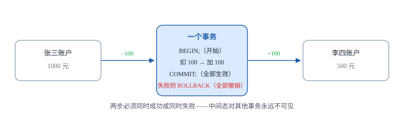
*图 1-1 转账事务示意：扣钱与加钱被绑定成一个不可分割的整体*

#### 例子：用 SQL 看一个两步事务（演示原子性）

```sql
-- 先建表并放入三行测试数据（后面所有例子都用它）
CREATE TABLE user (
  id INT PRIMARY KEY,
  name VARCHAR(20),
  age  INT
);
INSERT INTO user VALUES (1,'张三',20),(2,'李四',30),(3,'王五',40);

-- 下面两步更新被包在同一个事务里，演示原子性：要么全成功，要么全回滚
BEGIN;                                    -- 1. 开启事务
UPDATE user SET age = 22 WHERE id = 1;    -- 2. 第一步：把张三 age 改成 22
UPDATE user SET age = 32 WHERE id = 2;    -- 3. 第二步：把李四 age 改成 32
-- 此时如果断电 / 报错，执行 ROLLBACK; 上面两步全部撤销
COMMIT;                                   -- 4. 没问题才提交，两步永久生效
```

逐步说明：`BEGIN` 之后的所有操作都处于"未提交"状态，其他事务默认看不到；只有执行到 `COMMIT`，这些修改才真正落盘。任何一步失败，一句 `ROLLBACK` 就能全部撤回到事务开始前。

### 1.2 ACID：数据库对事务的四条承诺

> 🎯 **一句话总结：** ACID 是四个英文字母的缩写，是数据库厂商对事务"靠不靠谱"的四条承诺，分别是原子性、一致性、隔离性、持久性。

数据库为了兑现这四条承诺，在后台用了几种"日志"： **undo log** （回滚日志，记录修改前的旧值，用来撤销）、 **redo log** （重做日志，记录修改后的新值，宕机后用来恢复）。这里先记住名字即可，后面会用到。

| 概念 | 含义 | 靠什么保证 |
| --- | --- | --- |
| **原子性 A** | 事务里的操作要么全做、要么全不做，不允许做一半。 | 靠 undo log（回滚日志） |
| **一致性 C** | 事务前后，数据库里的数据必须合法（比如转账前后总额不变）。 | 这是最终目标，由 A / I / D 共同保证 |
| **隔离性 I** | 多个事务同时跑的时候，互相感觉不到对方在捣乱。 | 靠 锁 + MVCC（本指南后半部分） |
| **持久性 D** | 事务一旦提交，就算机器立刻断电，数据也不能丢。 | 靠 redo log（重做日志） |

> 🔑 💡 **本页最关键的因果链：** 隔离性要解决"多人同时操作数据库"时的互相干扰。但隔离性太强（大家都排队），并发就低；隔离性太弱，又会读出脏数据。于是数据库定义了四种"隔离级别"，让你自己在"安全"和"速度"之间选——这就是接下来两小节的内容。

### 1.3 并发时会出的三类问题：脏读 / 不可重复读 / 幻读

> 🎯 **一句话总结：** 当两个事务 T1、T2 同时操作同一份数据时，隔离性太弱就会冒出三种问题——脏读（读到未提交的数据）、不可重复读（同一行两次读出来不一样）、幻读（范围查询的行数"变魔术"）。

> 💡 **生活化类比：** 想象两个人共用一张白板写字。T1 刚在白板上写了个数字"25"但还没擦掉原来的"20"——如果 T2 这时候偷看，看到的就是"25"，结果 T1 发现写错了，改成"20"提交——T2 之前看到的"25"就是脏数据。三类问题的区别，就在于"到底是偷看了没提交的东西"，还是"提交后内容变了"，还是"提交后行数变了"。

| 并发问题 | 说明 |
| --- | --- |
| **脏读** | **核心：** T1 读到了 T2 **还没提交** 的修改，T2 随后回滚，T1 读到的就是无效数据。 <br> **关键词：** 未提交、回滚、无效 |
| **不可重复读** | **核心：** T1 两次读 **同一行** ，期间 T2 修改并提交了这一行，两次结果不同。 <br> **关键词：** 同一行、UPDATE / DELETE、内容变 |
| **幻读** | **核心：** T1 按条件范围查询，期间 T2 **插入或删除** 了符合条件的行并提交，T1 再次范围查询时行数变多/变少。 <br> **关键词：** 范围查询、INSERT / DELETE、行数变 |

#### ① 脏读：T1 读到了 T2 没提交的数

| 步骤 | T1（修改方） | T2（读取方） | 看到的结果 |
| --- | --- | --- | --- |
| 1 | BEGIN; 把张三 age 改成 25 | — | T1 还没 COMMIT |
| 2 | — | SELECT age FROM user WHERE id = 1; | 读到 25（其实是脏数据） |
| 3 | ROLLBACK; 张三 age 变回 20 | — | T1 反悔了 |
| 4 | — | T2 拿着"25"去做事 | 这个 25 在数据库里根本不存在过 |

```sql
-- T1
BEGIN;
UPDATE user SET age = 25 WHERE id = 1;   -- 没提交！

-- T2（隔离级别太弱时会执行）
SELECT age FROM user WHERE id = 1;        -- 竟然返回 25

-- T1
ROLLBACK;                                  -- 张三变回 20，T2 读到的 25 作废
```

说明：脏读的关键是 T2 读到了别人 **尚未提交** 的中间态数据。一旦对方回滚，这个数据就成了"垃圾"。

#### ② 不可重复读：T1 两次读同一行，结果不一样

| 步骤 | T1（读取方） | T2（修改方） | 看到的结果 |
| --- | --- | --- | --- |
| 1 | BEGIN; 第一次读张三 age | — | age = 20 |
| 2 | — | UPDATE user SET age = 30 WHERE id = 1; COMMIT; | T2 已提交，张三变成 30 |
| 3 | 第二次读同一行 | — | age = 30，和第一次不一样 |

```sql
-- T1
BEGIN;
SELECT age FROM user WHERE id = 1;   -- 第一次：20

-- T2
UPDATE user SET age = 30 WHERE id = 1;
COMMIT;                               -- T2 已提交

-- T1 继续
SELECT age FROM user WHERE id = 1;   -- 第二次：30（同一行，两次不一样）
```

说明：不可重复读的关键是 T2 已经 **提交** 了修改，T1 两次读同一行内容不同。问题聚焦在 **一行内容被 UPDATE / DELETE** 。

#### ③ 幻读：T1 按范围查，行数变多了一个"幻影"

| 步骤 | T1（读取方） | T2（插入方） | 看到的结果 |
| --- | --- | --- | --- |
| 1 | BEGIN; 查 age > 20 的人 | — | 2 行：李四 30、王五 40 |
| 2 | — | INSERT (4,'赵六',50); COMMIT; | T2 插入了一个符合条件的人并提交 |
| 3 | 再查同样的范围 | — | 变成 3 行，多出来"赵六" |

```sql
-- T1
BEGIN;
SELECT * FROM user WHERE age > 20;   -- 2 行（李四、王五）

-- T2
INSERT INTO user VALUES (4,'赵六',50);
COMMIT;                               -- 插入并提交

-- T1 继续
SELECT * FROM user WHERE age > 20;   -- 变成 3 行，多了"赵六"这个幻影
```

说明：幻读的关键是 T2 做了 **INSERT / DELETE** ，导致 T1 同一范围查询的 **行数** 变化。注意和不可重复读的区别：不可重复读是"同一行内容变了"，幻读是"行数变了"。

> ⚠️ **易错提醒：** 很多人把"不可重复读"和"幻读"搞混。记住一句话： **不可重复读针对 UPDATE / DELETE（改了已有行的内容），幻读针对 INSERT / DELETE（改了行数）** 。

### 1.4 四种隔离级别：给三类并发问题上"安全锁"

> 🎯 **一句话总结：** 数据库定义了四种隔离级别，从松到严依次是：读未提交（RU）→ 读已提交（RC）→ 可重复读（RR）→ 串行化（Serializable）。级别越高，并发问题越少，但并发性能也越低。

> 💡 **生活化类比：** 隔离级别就像地铁闸机——"读未提交"等于不查票，谁都能进，最挤但最快；"串行化"等于一次只放一个人进，最安全但最慢。中间两档是折中方案。

| 隔离级别 | 脏读 | 不可重复读 | 幻读 |
|---|---|---|---|
| 读未提交 RU<br> `Read Uncommitted` | 可能 | 可能 | 可能 |
| 读已提交 RC<br> `Read Committed` | 避免 | 可能 | 可能 |
| 可重复读 RR<br> `Repeatable Read` <br> `InnoDB 默认` | 避免 | 避免 | 快照读避免；当前读由 Next-Key Lock 防止 |
| 串行化 Serializable | 避免 | 避免 | 避免（全程加锁） |

> 🔑 📌 **考点：** InnoDB（MySQL 默认引擎）的默认隔离级别是 **RR（可重复读）** 。也就是说，在 MySQL 里你默认就能避免脏读和不可重复读；而幻读在"快照读"下也能避免，"当前读"则靠一种叫 Next-Key Lock（临键锁）的机制兜底——这些后面会展开。

### 📌 本页小结

- **事务** 是一组"要么全成功、要么全回滚"的操作，用转账理解最直观。
- **ACID** ：原子性靠 undo log、一致性是目标、隔离性靠锁+MVCC、持久性靠 redo log。
- **三类并发问题** ：脏读（读到未提交）、不可重复读（同一行 UPDATE/DELETE 导致内容变）、幻读（范围查询行数因 INSERT/DELETE 变化）。
- **四种隔离级别** 从松到严：RU → RC → RR → Serializable，越严越安全但越慢。
- **InnoDB 默认是 RR（可重复读）** ，这是后续 MVCC 学习的前提。

## 页签二 · MVCC 是什么

*本页回答：MVCC 为什么能让读写不互相阻塞？它由哪三部分组成？一条数据"能不能被看见"是怎么判断出来的？*

### 2.1 为什么需要 MVCC：让读写互不阻塞

> 🎯 **一句话总结：** MVCC（Multi-Version Concurrency Control，多版本并发控制）的核心思路是—— **读的时候不加锁，写的时候保留旧版本，让不同事务各自读自己该看到的那个版本** ，从而读写互不阻塞。

> 💡 **生活化类比：** 想象一本厚书被很多人同时翻。如果每次只能一个人翻，其他人排队——这是"锁"的思路。MVCC 的做法是：这本书每改一版，就复印一份旧版放在旁边，读者 A 看他借书那天的版本，读者 B 看他借书那天的版本，大家各看各的，互不干扰，也不互相挡路。

如果没有 MVCC，一个事务在改数据时，另一个事务想读同一条数据就只能排队等锁释放，并发度非常低。MVCC 让"快照读"（普通 SELECT）走另一套机制： **不读磁盘上的最新数据，而是读一个符合自己事务视角的"历史版本"** 。

> 🔑 📌 **MVCC 的三大组成** ：① **隐藏列** （每行数据后台自动带的几个"小尾巴"）；② **undo log 版本链** （把历史版本串成一条链）；③ **ReadView** （一份"我该看哪个版本"的快照档案）。下面逐个拆开看。

### 2.2 组成一：隐藏列（trx_id / roll_pointer / DB_ROW_ID）

> 🎯 **一句话总结：** 你在表里只定义了 id、name、age 三列，但 InnoDB 在磁盘上存每一行时，会偷偷在后面再加三列"隐藏列"，用来记录"这行最近被谁改过"、"改之前的旧值存在哪"。

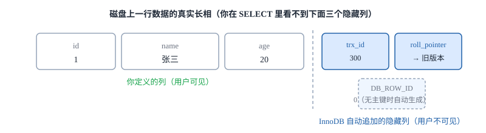
*图 2-1 一行数据的物理结构：业务列之外，InnoDB 自动加上 trx_id、roll_pointer、DB_ROW_ID*

#### trx_id

最近一次 **INSERT / UPDATE** 这一行的事务 ID。可以理解为"这行最新版本是被谁改的"。

#### roll_pointer

回滚指针。指向 undo log 里这一行的 **上一个旧版本** 。有了它，就能从当前行一路找到历史版本。

#### DB_ROW_ID

只有当表 **没有主键、也没有非空唯一索引** 时，InnoDB 才会自动生成的 6 字节行 ID。日常用主键的表不会显式出现，知道有这回事即可。

#### 关键配合

trx_id 告诉我们"谁改的"，roll_pointer 告诉我们"改之前长什么样"——这两个字段是 MVCC 的地基。

### 2.3 组成二：undo log 版本链

> 🎯 **一句话总结：** 每次修改一行，InnoDB 都会 **先把旧值写进 undo log（回滚日志），再去改当前行** ；当前行的 roll_pointer 指向这条旧记录，旧记录自己也有 roll_pointer 指向更早的一条，串成一条"版本链"。

> 💡 **生活化类比：** 就像微信的"聊天记录"——你今天改了昵称，昨天的旧昵称、前天的更旧昵称都被保存下来，顺着时间线一路往前翻就能看到。undo log 就是 InnoDB 给每一行数据留的"历史修改记录"。

#### ① 三种操作，undo log 里分别记什么？

写操作不同，undo log 保存的内容也不一样：

#### `UPDATE` 改一行

修改前先把 **被更新列的旧值 + 主键定位信息** 复制进 undo log，新值写进当前行。

回滚时凭 undo 里的旧值把行改回去。

#### `DELETE` 删一行

InnoDB 先做 **删除标记** （只打标记、不立刻物理删除，标记一下"这行已删"）；undo log 保存这一行的 **完整旧内容** 。

回滚时取消标记、恢复数据；提交后由 **purge 线程** （后台清理线程，专门负责删没用的旧数据）择机物理删除。

#### `INSERT` 插一行

undo log 主要保存 **该行主键** （定位信息），回滚时直接把插入的行删掉即可。

**insert undo 在事务提交后即可丢弃，不参与 MVCC 版本链** ，和 update undo 生命周期不同。

#### ② 一条 undo log 记录长什么样？

undo log 里的每条记录不是"一行完整数据"，而是一个结构化的小格子，告诉你"谁改的、改了什么、改之前是什么、再往前一条是谁"。

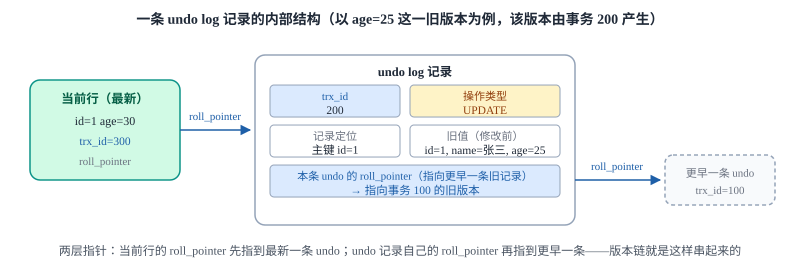
*图 2-2b 一条 undo log 记录的内部结构：trx_id / 操作类型 / 记录定位 / 旧值 / roll_pointer*

> ⚠️ **undo log 与 redo log 分工（呼应 1.2 节）：** undo log 记 **旧值** ，用于事务回滚 + MVCC 版本链；redo log 记 **新值** ，用于宕机后恢复已提交的数据。两者一个负责"撤销"，一个负责"重做"，别搞混。

#### ③ 版本链长什么样（重做图）

把上面的小格子拼起来，就能看到一行数据在多次修改后形成的完整版本链。例子沿用 user 表：事务 100 INSERT 初始行（age=20）→ 事务 200 UPDATE 成 25 → 事务 300 UPDATE 成 30。

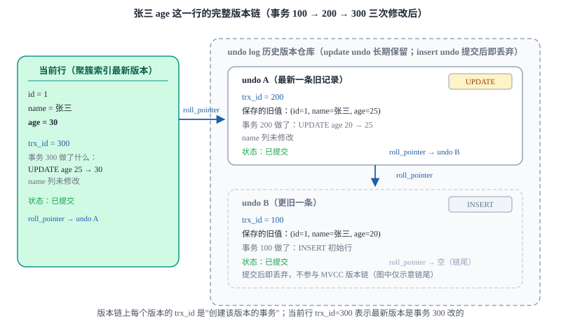
*图 2-2 undo log 版本链：当前行（最新）→ undo A（trx_id=200）→ undo B（trx_id=100），箭头均为 roll_pointer*

注：事务 100 的 insert undo 提交后即被清除，不进入 MVCC 版本链；图中画出它只是为了让链尾位置完整可见。

#### 例子：张三的 age 被改了三次，每次都写了什么 undo

```sql
-- 事务 100 INSERT 初始行（age = 20）
INSERT INTO user VALUES (1,'张三',20);
-- 这是 INSERT，产生的是 insert undo，提交后即可丢弃，不进版本链

-- 事务 200 改成 25 并提交
UPDATE user SET age = 25 WHERE id = 1;
-- 先写 undo：旧值 (id=1, name=张三, age=20)，操作类型 UPDATE
-- 再改当前行：age = 25

-- 事务 300 改成 30 并提交
UPDATE user SET age = 30 WHERE id = 1;
-- 先写 undo：旧值 (id=1, name=张三, age=25)，操作类型 UPDATE
-- 再改当前行：age = 30

-- 当前行：age = 30, trx_id = 300
-- 顺着 roll_pointer 找到 undo A：age = 25, trx_id = 200
-- 再顺着 roll_pointer 找到 undo B：age = 20, trx_id = 100
```

说明：版本链不是为了"备份"，而是为了让 **别的事务在合适的时机，能沿着链翻到自己该看到的那一页** 。

#### ④ 回滚演示：undo log 怎么把行恢复回去

如果事务 300 执行 UPDATE 后报错，InnoDB 就按 undo log 反向撤销：

| 步骤 | 动作 | 当前行 age |
|---|---|---|
| 1 | 事务 300 执行 `UPDATE age=30`，先把旧值 age=25 写进 undo log | 30（undo 里存 25） |
| 2 | 事务 300 报错，执行 `ROLLBACK`；沿 roll_pointer 找到本事务刚写下的那条 undo 记录 | 30 |
| 3 | 用 undo 里的旧值 age=25 把行改回去 | **25** （回到 UPDATE 之前） |

#### ⑤ 两类 undo 的生命周期区别

#### insert undo（插入产生）

事务 **提交后即可丢弃** 。因为 INSERT 的行提交后别人本来就能看见，不需要再用它做版本链。

#### update undo（更新/删除产生）

要保留到 **"没有任何事务还需要读这些旧版本"为止** （因为 MVCC 可能还要用它给快照读提供历史版本），再由 purge 线程清理。

#### ⑥ 按操作看：SELECT / UPDATE / INSERT / DELETE / DROP 分别怎么记录、怎么追溯旧版本

> 🎯 **一句话总结：** 同一条版本链，五类操作对它的写入方式完全不同——SELECT 只读不写、沿链回退；UPDATE/DELETE 写 update undo 改链头；INSERT 写 insert undo 但不进 MVCC 链；DROP 是 DDL 整表删除，根本没有行级 undo。

| 操作 | 是否写 undo、写哪种 | 是否改变版本链 | 旧版本如何被追溯 | 备注 |
|---|---|---|---|---|
| **SELECT** （普通快照读） | 不写 undo、不加行锁 | 不改变版本链 | 从当前行开始：当前版本可见就直接用；不可见则沿 roll_pointer 跳到上一条 undo 旧版本，按 ReadView 规则继续判断，直到找到可见版本 | `SELECT ... FOR UPDATE` 等当前读不追溯版本链，直接读最新已提交版本并加锁，详见页签 3 |
| **UPDATE** | 写一条 **update undo** （旧值 + 主键定位） | 链头插入新节点：当前行 trx_id 改本事务 ID，roll_pointer 指向新 undo；新 undo 的 roll_pointer 再指向链上更早旧版本 | 其他事务快照读沿链回退，能看到修改前的旧版本 | 先以当前读读到最新行并加 X 锁，再写 undo、再改当前行 |
| **INSERT** | 写一条 **insert undo** （仅存主键定位，用于回滚删行） | 新行本身没有旧版本，不在历史版本链上挂节点；提交后 insert undo 丢弃 | 未提交期间其他事务快照读依据 ReadView 判断该版本不可见；提交后该行直接可见 | insert undo 不参与 MVCC 版本链 |
| **DELETE** | 写一条 **update undo** （完整旧行内容） | 行先打删除标记（不立即物理删除）；当前行 trx_id 改本事务 ID；提交后由 purge 线程物理清除 | 其他事务在自己的快照里沿版本链读到的仍是删除前的行；自己事务回滚则取消标记恢复行 | DELETE 是行级 DML，走 undo + 版本链 |
| **DROP TABLE** （含 TRUNCATE） | **不产生行级 undo** | 表结构与整批行一次性移除，不进版本链 | 无旧版本可溯——提交后不存在"从版本链追溯这张表旧版本"的可能 | DDL 整表删除，与 DELETE 行级 DML 本质不同 |

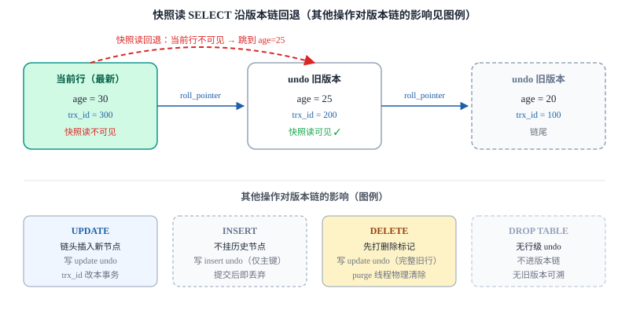
*图 2-2c 快照读 SELECT 沿版本链回退，以及五类操作对版本链的影响*

#### 例子：五类操作在版本链上的行为（沿用 user 表）

```sql
-- 假设另一个会话在做快照读
-- 1. SELECT：当前行 age=30 不可见，
--    沿 roll_pointer 回退到 age=25
SELECT age FROM user WHERE id = 1;   -- 快照读不加锁，沿链回退找可见版本

-- 2. UPDATE：先以当前读加 X 锁，
--    写 update undo（旧值 age=25），再改当前行
BEGIN;
UPDATE user SET age = 30 WHERE id = 1;   -- 链头插入新节点

-- 3. INSERT：新行直接写入，
--    产生 insert undo（仅主键定位）
INSERT INTO user VALUES (4,'赵六',50);    -- 不挂历史节点，提交后丢弃

-- 4. DELETE：先打删除标记，
--    把完整旧行写入 update undo
DELETE FROM user WHERE id = 3;           -- 其他事务快照读仍能读到删除前的王五

-- DROP TABLE：整表删除，不产生行级 undo
-- 无版本链可溯，与 DELETE 行级 DML 本质不同
-- DROP TABLE user;  -- DDL
```

说明：普通 SELECT 是快照读，沿版本链回退；UPDATE/DELETE 写 update undo 改链头；INSERT 写 insert undo 但不进 MVCC 链；DROP 是 DDL 整表删除，根本没有行级 undo。

### 2.4 组成三：ReadView（一致性视图）

> 🎯 **一句话总结：** 快照读的瞬间，InnoDB 会给当前事务生成一份"快照档案"叫 ReadView，里面记录了当时哪些事务还在活跃、哪些已经提交，用来判断"版本链上哪个版本对我是可见的"。

> 💡 **生活化类比：** ReadView 就像你借书那天在图书馆办的一张"权限卡"——卡片上写清楚："今天还没还书的人是 {100, 200, 300}，下一本要借的书号是 400，我自己是 350"。拿着这张卡去查任何一本书，都按这张卡的规则判断你能不能看。

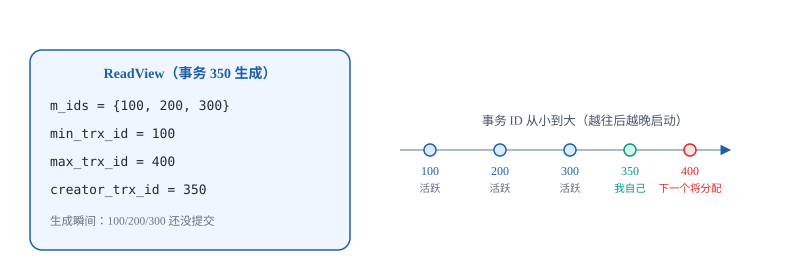
*图 2-3 ReadView 四个字段与事务 ID 时间轴的对应关系*

#### m_ids

生成 ReadView 时， **仍处于活跃状态（未提交）** 的事务 ID 列表。例子里是 {100, 200, 300}。

#### min_trx_id

就是 **m_ids 里最小的那个** 。例子里 = 100。

#### max_trx_id

系统 **下一个将分配** 的事务 ID（= 已分配最大 ID + 1）。 **注意：它不是"当前最大活跃 ID"，而是"下一个新事务要拿的号"** 。例子里 = 400。

#### creator_trx_id

创建这个 ReadView 的事务自己的 ID。例子里生成 ReadView 的是事务 350，所以 = 350。

> ⚠️ **易错提醒：** `max_trx_id` 不是"当前已经分配的最大事务 ID"，而是"系统下一个将要分配的事务 ID"。比如现在已分配到 350，那么 max_trx_id 就是 351（下一个新事务会拿的号）。这个口径在判断可见性时非常关键。

### 2.5 可见性判断：这一行到底能不能被我看见？

> 🎯 **一句话总结：** 拿当前行的 `trx_id` 和 ReadView 里的四个字段按顺序比一遍，就能决定这个版本对我可见还是不可见；不可见就沿版本链找旧版本，再比一遍。

1. **trx_id == creator_trx_id** ：这行是我自己事务改的， **可见** （自己改的当然要看得到）。
2. **trx_id < min_trx_id** ：改这行的事务在我生成 ReadView 之前就已经提交了， **可见** 。
3. **trx_id >= max_trx_id** ：改这行的事务在我生成 ReadView 之后才启动（或就是下一批）， **不可见** 。
4. **trx_id 在 m_ids 中** ：生成 ReadView 时它还在活跃， **不可见** ； **不在 m_ids 中** ：说明它已提交， **可见** 。

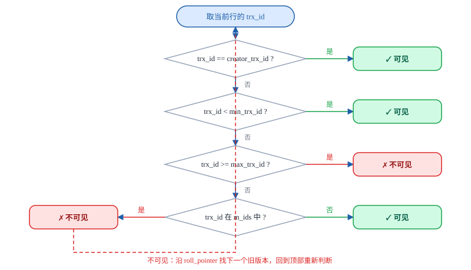
*图 2-4 可见性判断决策流程：四条规则按顺序判断，不可见就沿版本链找旧版本*

> 🔑 📌 **关键补充：** 如果当前版本判断下来"不可见"，InnoDB 不会直接报错，而是 **顺着 roll_pointer 走到 undo log 里的旧版本，再用同样四条规则重新判断一次** ，直到找到一个可见的版本为止；整条链都不可见才返回空。这就是为什么 MVCC 能"让每个事务看到自己该看到的数据"。

#### 例子：用上面的 ReadView 套一遍

假设 ReadView 是事务 350 生成的：m_ids={100,200,300}，min_trx_id=100，max_trx_id=400。

```sql
-- 场景1：当前行 trx_id = 250（已提交，不在 m_ids）
-- 规则1 不等 / 规则2 250 < 100 否 / 规则3 250 >= 400 否 / 规则4 250 不在 m_ids
-- 结论：可见 ✓

-- 场景2：当前行 trx_id = 200（生成 ReadView 时还在活跃）
-- 规则1/2/3 都不命中，规则4：200 在 m_ids 中
-- 结论：不可见 ✗，沿 roll_pointer 找上一个旧版本再判断

-- 场景3：当前行 trx_id = 450（ReadView 生成之后才启动）
-- 规则3：450 >= 400，直接命中
-- 结论：不可见 ✗，沿版本链找旧版本

-- 场景4：当前行 trx_id = 350（自己事务改的）
-- 规则1：350 == 350，直接命中
-- 结论：可见 ✓
```

说明：四条规则是 **按顺序** 短路判断的，命中即出结论，不用再往下比。

### 📌 本页小结

- **MVCC** 让快照读不加锁、读写互不阻塞，靠"多版本 + 快照"提升并发。
- **三大组成** ：隐藏列（trx_id / roll_pointer / DB_ROW_ID）、undo log 版本链、ReadView。
- **版本链** ：每次修改把旧值写进 undo log，当前行用 roll_pointer 串起所有历史版本。
- **ReadView 四字段** ：m_ids（生成时活跃事务列表）、min_trx_id（m_ids 最小）、max_trx_id（下一个将分配的事务 ID）、creator_trx_id（自己）。
- **可见性四规则** ：自己改的可见 / 小于 min_trx_id 已提交可见 / 大于等于 max_trx_id 不可见 / 在 m_ids 中不可见、不在则可见。
- **不可见就沿版本链找旧版本** ，重复判断直到找到可见版本。
- **undo 记录了什么** ：trx_id（哪个事务）、操作类型（INSERT/UPDATE/DELETE）、记录定位（主键）、旧值（修改前各列）、roll_pointer（指向上一条旧记录）。
- **两类 undo 生命周期不同** ：insert undo 提交即可清除；update undo 要等"没有任何事务还需要读这些旧版本"后，才由 purge 线程清理（MVCC 版本链靠它们撑着）。
- **五类操作对版本链的影响** ：SELECT 不写只沿链回退；UPDATE/DELETE 写 update undo 改链头；INSERT 写 insert undo 但不进 MVCC 链；DROP 无行级 undo、无链可溯。

## 页签三 · 快照读 vs 当前读

*本页回答：同样是 SELECT，为什么有的读不加锁、有的读却会阻塞别人？RC 和 RR 的差别，到底是怎么靠"什么时候生成快照"决定的？*

### 3.1 快照读：普通 SELECT，走 MVCC、不加行锁

> 🎯 **一句话总结：** 不加任何锁的普通查询就是快照读——它通过 MVCC（多版本并发控制）去读"某个历史版本的快照"，读写互不阻塞。

> 💡 **生活化类比：** 快照读就像给数据拍了一张"老照片"。你事务开始后拍了一张照片，之后别人怎么改原表，你看到的永远是那张老照片上的内容，不会被别人挡住，也不会挡住别人。

上一页讲过，MVCC 靠三个东西实现：行后面的隐藏列（trx_id、roll_pointer）、undo log 里串起来的版本链、以及 ReadView（一致性视图）。普通 SELECT 走的就是这条路线：

#### 哪些 SQL 是快照读

```sql
-- 普通 SELECT，不加任何行锁，读快照版本
SELECT * FROM user WHERE id = 1;
SELECT * FROM user WHERE age >= 30;
```

判断口诀： **只要 SELECT 后面没有 FOR UPDATE / FOR SHARE / LOCK IN SHARE MODE** ，就是快照读。它读的是"一致性视图"里的可见版本，不写锁，别的事务也不用等它。

> ⚠️ **易错点：** 普通 SELECT **不会** 加共享锁（S 锁）！它连 S 锁都不加，直接靠 MVCC 读旧版本。很多初学者以为"读就要加读锁"，这是传统表锁时代的观念；在 InnoDB 里普通 SELECT 并不适用。

### 3.2 当前读：读最新版本并加锁

> 🎯 **一句话总结：** 当前读就是"我要看最新的已提交数据，并且我要锁住它，别人在我改之前不能动"——读的是最新版本，同时按性质加 S 锁或 X 锁。

> 💡 **生活化类比：** 快照读是"拍照自己看"，当前读是"我直接把手伸到桌子上，把这张单子按住，别人在我松手之前不能拿走也不能改"。你看到的一定是最新的，代价是要排队。

当前读分两类，加的锁性质不同：

#### 哪些 SQL 是当前读

```sql
-- ① SELECT ... FOR UPDATE：加 X 锁（排他写锁），读完准备自己改
SELECT * FROM user WHERE id = 1 FOR UPDATE;

-- ② SELECT ... LOCK IN SHARE MODE：加 S 锁（共享读锁）
SELECT * FROM user WHERE id = 1 LOCK IN SHARE MODE;
-- MySQL 8.0 也支持新写法：
SELECT * FROM user WHERE id = 1 FOR SHARE;

-- ③ 写操作一律是当前读，先读最新版本再写，加 X 锁
UPDATE user SET age = 21 WHERE id = 1;
DELETE FROM user WHERE id = 1;
INSERT INTO user VALUES (4, '赵六', 50);  -- INSERT 前先做唯一性检查的当前读并加锁
```

| 当前读 SQL | 加的锁 | 读的版本 |
|---|---|---|
| `SELECT ... FOR UPDATE` | X 锁（排他） | 最新已提交版本 |
| `SELECT ... LOCK IN SHARE MODE` / `FOR SHARE` | S 锁（共享） | 最新已提交版本 |
| `UPDATE` / `DELETE` / `INSERT` | X 锁（排他） | 最新已提交版本 |

### 3.3 一张表看懂：快照读 vs 当前读

#### 快照读（一致性非锁定读）

`普通 SELECT`

- 走 **MVCC** ，读 undo log 版本链里的可见版本
- **不加任何行锁** ，读写不阻塞
- 看到的是"快照那一刻"的版本
- 作用：解决不可重复读、避免脏读（靠 ReadView）

#### 当前读（锁定读）

`FOR UPDATE / FOR SHARE / 写操作`

- 走 **锁机制** ，读最新已提交版本
- 按性质加 **S 锁** 或 **X 锁**
- 看到的是"此时此刻"的最新数据
- 作用：保证同一条记录的修改互斥，防当前读幻读

> 🔑 💡 **核心结论：** 快照读走 MVCC、不加行锁；当前读走锁机制、读最新已提交版本。一个事务里可以两种读混用——但混用的时候，就会暴露 RR 也防不住的幻读（页签五会细讲）。

### 3.4 RC 与 RR 的关键差别：ReadView 什么时候生成

> 🎯 **一句话总结：** RC 是"每次快照读都重新拍一张快照"，RR 是"整个事务只拍一张、后面反复用"——就这一个时机差别，决定了能不能重复读。

> 💡 **生活化类比：** RC 像你每次打开手机都重新刷一次朋友圈（能看到别人新发的）；RR 像你今天只截一次图存相册，之后每次打开相册都看同一张截图（别人发什么你都看不见）。

| 隔离级别 | ReadView 生成时机 | 效果 |
|---|---|---|
| **RC（读已提交）** | **每次** 快照读都新建一个 ReadView | 能看到别的事务新提交的数据 → **不可重复读** |
| **RR（可重复读）** | 事务中 **第一次** 快照读时生成，之后一直 **复用** | 两次读到的版本一致 → 解决不可重复读与快照读幻读 |

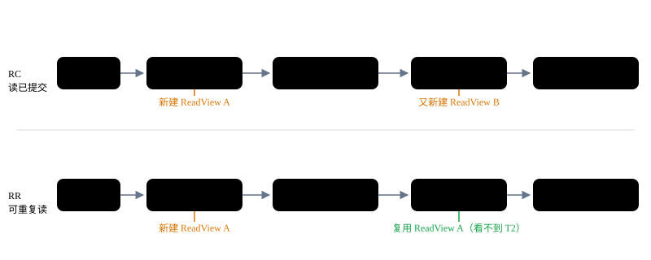
*图 3-1 RC 与 RR 下 ReadView 生成时机对比（同一批 SQL，结果不同）*

### 3.5 逐步例子：同一个事务，RC 与 RR 分别看到什么

准备数据：user 表初始为 (1,张三,20)、(2,李四,30)、(3,王五,40)。T1 想两次读李四，T2 中途把李四改成 35 并提交。

#### ① 在 RC（读已提交）下

```sql
-- 事务 T1
BEGIN;
SELECT age FROM user WHERE id = 2;   -- 第 1 次读：生成 ReadView A
-- 此时 age = 30
-- ========== 事务 T2 修改并提交 ==========
UPDATE user SET age = 35 WHERE id = 2;
COMMIT;
-- ========================================
SELECT age FROM user WHERE id = 2;   -- 第 2 次读：又生成 ReadView B
-- 此时 age = 35  ✅ 看到了 T2 的提交
COMMIT;
```

**逐步说明：** 第 2 次 SELECT 是新的快照读，会重新建一个 ReadView，T2 在它生成前已经提交，按可见性规则"不在 m_ids 中"→ 可见，于是 T1 读到了 35。 **两次读同一行结果不一样 → 这就是不可重复读** 。

#### ② 在 RR（可重复读）下

```sql
-- 事务 T1
BEGIN;
SELECT age FROM user WHERE id = 2;   -- 第 1 次读：首次生成 ReadView A
-- 此时 age = 30
-- ========== 事务 T2 修改并提交 ==========
UPDATE user SET age = 35 WHERE id = 2;
COMMIT;
-- ========================================
SELECT age FROM user WHERE id = 2;   -- 第 2 次读：复用 ReadView A
-- 此时 age 仍然 = 30  ❌ 看不到 T2 的提交
COMMIT;
```

**逐步说明：** 第 2 次 SELECT 复用的还是第一次那个 ReadView A。T2 的 trx_id 是在 ReadView A 生成之后才开始的，按规则"trx_id ≥ max_trx_id → 不可见"，于是 T1 沿版本链回退到 30 那个旧版本。 **两次读都是 30 → 不可重复读被解决了** ，这也是 MVCC 防住快照读幻读的原理：T2 新插入的行在 T1 眼里"从未存在"。

> ⚠️ **注意：** 这个"复用"只对 **快照读** 有效。如果 T1 第二次读改用 `SELECT ... FOR UPDATE`（当前读），它就不再看 ReadView 了，而是直接读最新已提交版本——这时 T2 提交的 35 立刻就会暴露出来。这个"RR 也防不住的幻读漏洞"，页签五会用 Next-Key Lock 补上。

### 📌 本页小结

- 普通 `SELECT` 是 **快照读** ：走 MVCC、不加行锁、读快照版本；`FOR UPDATE` 加 X 锁、`LOCK IN SHARE MODE` / `FOR SHARE` 加 S 锁、`UPDATE/DELETE/INSERT` 加 X 锁，统称 **当前读** ，读最新已提交版本。
- 普通 SELECT 不会加 S 锁，别把"读操作"和"加共享锁"划等号。
- **RC** ：每次快照读都新建 ReadView → 能看到别人新提交 → 不可重复读。
- **RR** ：第一次快照读生成 ReadView，之后一直复用 → 两次读一致 → 解决不可重复读与快照读幻读。
- 这个"复用"只保护快照读；当前读（FOR UPDATE / 写）不受 ReadView 约束，直接读最新版本。

## 页签四 · 事务锁体系

*本页回答：InnoDB 到底有哪些锁？行锁是锁在"物理行"上吗？Record、Gap、Next-Key 三种锁分别锁哪一段区间？为什么意向锁又叫"门口告示"？*

### 4.1 锁分类总览：先建一张全景地图

> 🎯 **一句话总结：** InnoDB 的锁可以从三个角度看——按粒度分表锁/行锁，按性质分 S 锁/X 锁，行锁再按锁的范围分 Record、Gap、Next-Key 三种算法；另外还有意向锁、自增锁这类辅助锁。

> 💡 **生活化类比：** 想象图书馆自习室。表锁=把整个自习室大门锁上；行锁=只锁某一张桌子。S 锁="看书的人"，多个人可以同时坐；X 锁="占桌子干活的人"，别人不能靠近。意向锁=门口告示牌"里面有人在占座"。


*图 4-1 InnoDB 锁分类总览树状图*

### 4.2 按性质：S 锁与 X 锁

> 🎯 **一句话总结：** S 锁（共享锁/读锁）大家可以一起持有；X 锁（排他锁/写锁）一旦有人拿了，谁都不能再拿——不管是 S 还是 X。

> 💡 **生活化类比：** S 锁像"阅览室的座位"——谁都可以进来看书，互不干扰；X 锁像"包间"——你进去之后就把门反锁，别人既不能进，也不能再在里面看书。

| 已持有 ↓ \ 请求 → | S 锁 | X 锁 |
|---|---|---|
| **S 锁** | 兼容 ✅（都能读） | 冲突 ❌（要等读完） |
| **X 锁** | 冲突 ❌ | 冲突 ❌ |

记法： **读读共存，读写互斥，写写互斥** 。这就是后面所有行锁、表锁的兼容性基础。

#### 例子：两条事务分别拿 S 锁和 X 锁

```sql
-- T1：给 id=1 加 S 锁（共享读锁）
BEGIN;
SELECT * FROM user WHERE id = 1 LOCK IN SHARE MODE;
-- T2：想给 id=1 加 X 锁（写锁），会被 T1 挡住
BEGIN;
UPDATE user SET age = 21 WHERE id = 1;   -- 阻塞，直到 T1 提交或回滚
-- T1 提交后，T2 才能拿到 X 锁并执行
```

逐步说明：T1 拿了 S 锁还没松手，T2 要写同一行就必须等——S 与 X 冲突。如果 T2 只是普通 `SELECT`（快照读），它根本不加锁，也就不会被挡，直接读 MVCC 快照。

### 4.3 行锁到底锁在哪？——锁的是索引记录，不是物理行

> 🎯 **一句话总结：** InnoDB 没有"锁物理行"这回事，它的行锁是 **加在索引记录上** 的；查询走了哪个索引，就锁哪个索引上的记录。

> 💡 **生活化类比：** 图书馆不是按"书架上第几排第几层"来占位的，而是按"目录卡片上的编号"来占位的。你查目录卡，就锁那张卡片；你根本没翻目录卡，而是把整本书库翻一遍，那你每张卡片都得摸一遍——也就等于每张都被你暂时占了。

> ⚠️ **重点提醒：** 如果你的查询条件 **没有走索引** （比如 `WHERE age = 30` 而 age 没建索引），InnoDB 会扫描全表的每一条索引记录并加锁，实际效果 **近似锁全表** 。这就是"不走索引会锁死别的事务"的根本原因——不是锁了物理行，而是扫了太多索引记录。

### 4.4 行锁三种算法：Record / Gap / Next-Key

> 🎯 **一句话总结：** Record Lock 锁单条记录；Gap Lock 锁两条记录之间的开区间（只在 RR 生效）；Next-Key Lock = Record + 前向 Gap，锁左开右闭区间 `(前一条记录, 当前记录]`，是 RR 下的默认行锁。

假设索引上已经排好序的记录是 5、10、15。下面三张图分别演示"锁定记录 10"时三种锁的覆盖区间（实心点=被锁住，空心点=不锁端点）：


*图 4-2 Record Lock：等值命中唯一记录时，只锁这一条本身*


*图 4-3 Gap Lock：锁的是"两记录之间的空隙"，不锁记录本身，目的是防止往中间插数据*


*图 4-4 Next-Key Lock：Record 锁 + 前向 Gap 锁，左开右闭，RR 下的默认行锁*

> 🔑 💡 **为什么这样设计：** 只锁记录 10（Record）挡不住别人在 5 和 10 之间插入一条 7——那样你的范围查询下次就会多一行，这就是幻读。所以 RR 默认把"记录本身 + 前面一段空隙"一起锁住，别的事务既改不了 10，也插不进 (5,10)，幻读就被堵住了。

### 4.5 退化规则：什么时候 Next-Key Lock 会"缩水"

> 🎯 **一句话总结：** RR 默认用 Next-Key Lock，但命中唯一索引等值查询时会"缩水"——记录存在就退成 Record Lock，记录不存在就退成 Gap Lock。

1. **唯一索引等值 + 记录存在**：比如 `WHERE id = 10`，id 是主键（唯一索引），且 10 确实存在 → 只锁这一条就够， **退化为 Record Lock** 。
2. **唯一索引等值 + 记录不存在**：比如 `WHERE id = 7`，索引上没有 7 → 没有 Record 可锁， **退化为 Gap Lock** （锁住 5 和 10 之间的空隙，防止别人立刻插一条 7）。
3. **普通索引等值 / 范围查询**：普通索引上的值可能重复，范围查询更是天然跨区间 → **保持 Next-Key Lock** ，不退化。

> ⚠️ **记忆要点：** 唯一索引等值查询能"精确定位"，没必要再锁住间隙，所以退化；普通索引/范围查询定位不精确，老老实实用 Next-Key Lock。

### 4.6 意向锁 IS / IX：门口的告示牌

> 🎯 **一句话总结：** 事务要加行 S 锁前，先在表上加一个 IS；要加行 X 锁前，先在表上加一个 IX。它们是表级锁，作用是让别人判断"这张表上有没有行被锁"时，不用逐行去查。

> 💡 **生活化类比：** 自习室门口挂了一块告示牌："本室内有人占座（IX）"。你想把整个自习室锁起来装修（表级 X 锁），先看一眼告示牌就知道要不要等——不用推门进去挨个桌子看。这就是意向锁的意义： **先挂牌子，再占座** 。

| 已持有 ↓ \ 请求 → | IS | IX | S | X |
|---|---|---|---|---|
| **IS** | 兼容 ✅ | 兼容 ✅ | 兼容 ✅ | 冲突 ❌ |
| **IX** | 兼容 ✅ | 兼容 ✅ | 冲突 ❌ | 冲突 ❌ |
| **S** | 兼容 ✅ | 冲突 ❌ | 兼容 ✅ | 冲突 ❌ |
| **X** | 冲突 ❌ | 冲突 ❌ | 冲突 ❌ | 冲突 ❌ |

重点看 **意向锁自己之间** ：IS-IS、IS-IX、IX-IX 全部兼容——大家都"挂了牌子"，互不阻塞。只有当有人要加 **表级 S / X 锁** 时，才会去对照这些告示牌判断是否等待。

另外一句话带过： **AUTO-INC 锁** 是给自增主键分配 ID 时用的表级锁，保证同一时刻只有一个事务能拿到新的自增值，不展开。

### 📌 本页小结

- 按性质分：S 锁（共享，读读共存）、X 锁（排他，与任何锁都互斥）；按粒度分：表锁、行锁。
- 行锁锁的是 **索引记录** ，不是物理行；查询不走索引会扫描全部索引记录加锁，效果近似锁全表。
- Record Lock 锁单条记录；Gap Lock 锁两记录间开区间、 **只在 RR 生效** ；Next-Key Lock = Record + 前向 Gap，锁 `(前一条, 当前记录]`，RR 默认、防幻读。
- 退化规则：唯一索引等值+记录存在 → Record Lock；唯一索引等值+记录不存在 → Gap Lock；普通索引等值/范围 → 保持 Next-Key Lock。
- 意向锁 IS/IX 是"门口告示"，先挂牌子再加行锁；意向锁之间互相兼容，与表级锁的冲突按矩阵判断（IS 与 S 兼容、与 X 冲突；IX 与 S、X 都冲突）。
- AUTO-INC 锁：自增主键分配时的表级锁，一句话了解即可。

## 页签五 · MVCC 与锁的关联（核心页签）

*本页回答：为什么普通 SELECT 不加锁？FOR UPDATE 为什么一定要加锁？幻读到底是被谁解决的——MVCC 还是锁？一句话把前面所有页签串起来。*

### 5.1 一句话核心结论：InnoDB 并发控制的"两条腿"

> 🔑 **快照读走 MVCC、不加行锁** （普通 SELECT 读快照版本）； **当前读走锁机制、读最新已提交版本** （FOR UPDATE / UPDATE / DELETE / INSERT 都加锁）。两条腿分工明确，合起来才是 InnoDB 完整的并发控制。

> 🎯 **一句话总结：** 不是所有 SELECT 都一样——普通 SELECT 是"翻旧快照"，FOR UPDATE / UPDATE 这类是"站在最新数据上动手"，前者靠 MVCC 免锁，后者靠锁互斥。

> 💡 **生活化类比：** MVCC 像图书馆里的"开架借阅"：每个人拿的是同一本书的不同版本，各看各的、互不干扰，谁也不用锁谁；锁则像"会议室门口的签到牌"：有人要在白板上改数据时，其他人必须排队等他改完，保证改的是最新状态。

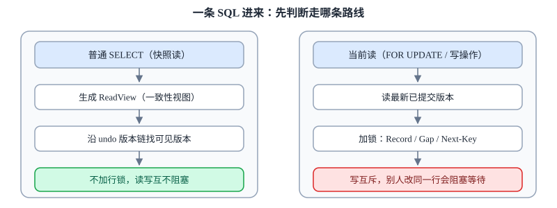
*图 5-1 快照读（MVCC）与当前读（锁）两条路线的分工*

### 5.2 为什么快照读不需要锁，当前读却必须加锁？

#### 快照读为什么不需要锁？

普通 SELECT 不申请任何行锁，因为它有 **ReadView（一致性视图）+ undo log 版本链** 这一套"快照档案"：

- 每个事务读到的都是自己那份快照里的版本，不是别人正在改的数据；
- 别人写别人的（写到最新版本），你读你的（读快照里的旧版本）， **读写互不阻塞** ；
- 所以"读多写少"的业务里，普通 SELECT 再多也不会互相卡住。

#### 当前读为什么必须加锁？

FOR UPDATE / UPDATE / DELETE / INSERT 要的是 **最新已提交版本** ，不是快照：

- 你 UPDATE 一行时必须以它当前最新值为准，否则改完会覆盖别人刚提交的修改；
- 同一行的修改必须 **互斥** ——一人写、其他人等；
- 所以当前读在读取的同时，就在索引记录上加上 Record / Gap / Next-Key 锁。

### 5.3 幻读的完整答案：MVCC 和 Next-Key Lock 各管一半

> 🎯 **一句话总结：** 快照读的幻读由 MVCC 解决（RR 复用同一个 ReadView，看不到别的事务新插入的行）；当前读的幻读由 Next-Key Lock（记录锁 + 间隙锁）锁住查询区间、防止别人插入。

> 💡 **生活化类比：** MVCC 像给你发"进场那一刻的合影"：你在会议室里永远只看这张合影，后来被搬进来的新椅子，照片里永远没有；Next-Key Lock 像干脆把会议室门口派人守着：谁也别想趁你开会时把新椅子搬进来。一个管"眼睛看什么"，一个管"门能不能进人"。


*图 5-2 幻读双保险：MVCC 管"眼睛"，Next-Key Lock 管"门"*

#### 时序表 A：快照读视角下，MVCC 挡住了新行

| 步骤 | 事务 T1（RR 级别） | 事务 T2 | 看到什么 / 加了什么锁 |
| --- | --- | --- | --- |
| 1 | BEGIN;<br>SELECT * FROM user WHERE id > 1; | — | 返回 2 李四 30、3 王五 40；RR 在 **第一次快照读** 时生成 ReadView，此时 T2 还未启动 |
| 2 | （等待中） | INSERT INTO user VALUES (4,'赵六',50);<br>COMMIT; | 插入并提交成功，MVCC 不阻塞写 |
| 3 | 再次 SELECT * FROM user WHERE id > 1; | （已提交） | 仍返回 2、3 两行，看不到 id=4——T2 的 trx_id 是在 ReadView 生成之后才启动的，版本链上判为不可见 |
| 4 | COMMIT; | — | 再开一个 **新事务** 去 SELECT，才看得到 2、3、4 三行 |

#### 时序表 B：当前读视角下，Next-Key Lock 挡住了插入

| 步骤 | 事务 T1（RR 级别） | 事务 T2 | 看到什么 / 加了什么锁 |
| --- | --- | --- | --- |
| 1 | BEGIN;<br>SELECT * FROM user WHERE id > 1 FOR UPDATE; | — | 返回 2、3；这是当前读，在主键索引上依次加 Next-Key Lock，锁住 (1,2]、(2,3]、(3,+∞) 等区间（合起来就是 id>1 的整个范围） |
| 2 | （等待中） | INSERT INTO user VALUES (4,'赵六',50); | 阻塞等待——id=4 落在被锁的间隙里，插不进来 |
| 3 | 再次 SELECT * FROM user WHERE id > 1 FOR UPDATE; | （一直等待） | 仍返回 2、3 两行，不会出现"新冒出来的行"——T2 根本没机会插 |
| 4 | COMMIT; | （继续执行） | T1 提交、Next-Key Lock 释放，T2 的 INSERT 才执行成功 |
| 5 | — | COMMIT; | 新事务再 SELECT ... FOR UPDATE 才看得到 2、3、4 |

### 5.4 一张总结表：隔离级别 × 读类型 × 是否加锁 × 解决的问题

| 隔离级别 | 读类型 | 是否加行锁 | 解决 / 不解决什么 |
|---|---|---|---|
| `RC` 读已提交 | 快照读（普通 SELECT） | **不加锁** | 每次读都新建 ReadView，避免脏读；但仍有不可重复读、快照读幻读 |
| `RC` 读已提交 | 当前读（FOR UPDATE / UPDATE / DELETE） | 加 Record X 锁（ **无间隙锁** ） | 读最新已提交、写互斥；但不防别人往间隙插入 |
| `RR` 可重复读 | 快照读（普通 SELECT） | **不加锁** | 复用同一 ReadView：避免不可重复读 + 快照读幻读 |
| `RR` 可重复读 | 当前读（FOR UPDATE / UPDATE / DELETE） | Record / Gap / Next-Key Lock | 读最新已提交 + 锁住查询区间，防止当前读幻读 |

### 5.5 经典考点警告：RR 也不是"完全没有幻读"

> ⚠️ **注意：** 同一事务中 **先做快照读、再做一次当前读** ，期间 T2 插入并提交——快照读那一眼挡住了新行，可当前读不看 ReadView、只认最新已提交数据，于是你会在同一事务里"幻"出一行。这就是 **MVCC 不覆盖当前读** ，必须再配合 Next-Key Lock 的原因。

#### 例子：同一事务里"先快照读、再当前读"

```sql
-- T1（RR）
BEGIN;
SELECT * FROM user WHERE id > 1;          -- 快照读：看到 2、3（此刻生成 ReadView）

-- T2 此时执行：INSERT INTO user VALUES (4,'赵六',50); COMMIT;

-- T1 再执行
SELECT * FROM user WHERE id > 1;          -- 快照读：仍是 2、3
SELECT * FROM user WHERE id > 1 FOR UPDATE; -- 当前读：竟然看到 2、3、4（幻！）
```

逐步说明：第 2 步快照读仍走 MVCC、看不到新行；第 3 步 FOR UPDATE 是当前读，读的是"最新已提交版本"，所以 T2 已提交的 id=4 就冒了出来。生产中要彻底防住这一类，就靠 Next-Key Lock 在区间上把插入挡住。

### 📌 本页小结

- 快照读走 MVCC、不加行锁；当前读走锁机制、读最新已提交版本。
- 快照读不需要锁：ReadView + 版本链已提供一致性视图，读写互不阻塞。
- 当前读必须加锁：要读最新已提交数据，且同一行修改互斥。
- 幻读双保险：RR 下快照读幻读由 MVCC（复用 ReadView）解决；当前读幻读由 Next-Key Lock（锁区间防插入）防止。
- 经典考点：同一事务先快照读再当前读，期间别人插入提交，当前读仍会读到新行——MVCC 不覆盖当前读。

## 页签六 · 综合实战 + 常见误区 + 知识地图

*本页用两段完整并发实战把 MVCC 和锁"跑一遍"，再澄清六条最容易记错的说法，最后用一张知识地图把前面所有页签串成网。*

### 6.1 实战场景一：MVCC 生效——同一事务里两次读同一行，结果一致

> 🎯 **一句话总结：** RR 级别下，T1 两次普通 SELECT 同一行，期间 T2 把这行改了并提交，T1 两次看到的还是旧值——因为它复用的是第一次快照读时生成的 ReadView。

> 💡 **生活化类比：** 你走进房间时拍了一张快照（ReadView）。之后别人把房间里的日历翻了一页（UPDATE 并提交），但你手里始终看的是那张快照照片——照片里的日期永远不变；等你出门、再推门进来（新事务），才看到新日历。

#### 完整 SQL（表中已有 id=1 张三 age=20）

```sql
-- T1（RR 级别）
BEGIN;
SELECT age FROM user WHERE id = 1;          -- 第 1 次读

-- T2
UPDATE user SET age = 21 WHERE id = 1;
COMMIT;                                     -- 改完并提交

-- T1 继续
SELECT age FROM user WHERE id = 1;          -- 第 2 次读
COMMIT;

-- T3（新事务）
SELECT age FROM user WHERE id = 1;          -- 新快照
```

逐步说明：

| 步骤 | 事务 T1 | 事务 T2 | 看到什么 / 加了什么锁 |
| --- | --- | --- | --- |
| 1 | BEGIN;<br>SELECT age FROM user WHERE id = 1; | — | 结果 20；RR 在这次快照读时生成 ReadView |
| 2 | （等待中） | UPDATE user SET age = 21 WHERE id = 1;<br>COMMIT; | 更新成功并提交；MVCC 不加锁，所以 T2 不被 T1 阻塞 |
| 3 | 再次 SELECT age FROM user WHERE id = 1; | （已提交） | 结果仍是 20——T2 的 trx_id 在 ReadView 里判为不可见，沿版本链退回旧版本 |
| 4 | COMMIT; | — | T3 新事务 SELECT 才看到 结果 21 |

### 6.2 实战场景二：锁生效——FOR UPDATE 后，别人 UPDATE 同一行被阻塞

> 🎯 **一句话总结：** T1 用 FOR UPDATE 当前读 id=1 这行，就在主键索引记录 id=1 上加了一把 Record X 锁；T2 想 UPDATE 同一行必须等 T1 提交后才能继续。

> 💡 **生活化类比：** FOR UPDATE 像你在白板上"贴了自己的名字"：你不擦掉走人（COMMIT），别人就没法在这块白板上写东西——只能在旁边排队等着。

#### 完整 SQL

```sql
-- T1（RR 级别）
BEGIN;
SELECT * FROM user WHERE id = 1 FOR UPDATE;  -- 当前读 + 加锁

-- T2
UPDATE user SET age = 22 WHERE id = 1;        -- 阻塞等待

-- T1
COMMIT;                                      -- 释放锁

-- T2 才继续执行，更新成功
```

逐步说明：

| 步骤 | 事务 T1 | 事务 T2 | 看到什么 / 加了什么锁 |
| --- | --- | --- | --- |
| 1 | BEGIN;<br>SELECT * FROM user WHERE id = 1 FOR UPDATE; | — | 读到 id=1 最新行； **唯一索引等值查询、记录存在，Next-Key Lock 退化为 Record Lock** ，在索引记录 id=1 上加 Record X 锁 |
| 2 | （等待中） | UPDATE user SET age = 22 WHERE id = 1; | 阻塞等待——X 锁与 X 锁互斥，T2 必须等 T1 提交 |
| 3 | COMMIT; | （继续执行） | T1 提交，Record X 锁释放，T2 的 UPDATE 才执行成功 |

### 6.3 常见误区六条：错误说法 → 正确结论

#### 误区 1：MVCC 是一种锁

✗ MVCC 就是"多版本锁"。

✓ MVCC 不是锁，它不加锁；是"多版本 + 快照读"机制，锁是另一套机制。

#### 误区 2：所有隔离级别都有间隙锁

✗ 任何级别下都有 Gap Lock。

✓ 间隙锁只在 RR（及以上）级别生效；RC 没有间隙锁。

#### 误区 3：行锁锁住的是物理行

✗ UPDATE 一行，就把那行物理数据锁住了。

✓ 行锁加在索引记录上，不是物理行；查询不走索引会扫描并锁住更多记录。

#### 误区 4：普通 SELECT 会加 S 锁

✗ 只要 SELECT 就会上共享锁。

✓ 普通 SELECT 不加 S 锁；只有 LOCK IN SHARE MODE / FOR SHARE 才加共享锁。

#### 误区 5：MySQL 默认隔离级别和 Oracle/PG 一样

✗ 默认都是 RC。

✓ InnoDB 默认是 RR；Oracle、PostgreSQL 默认是 RC。

#### 误区 6：RR 下 MVCC 把幻读彻底解决了

✗ 开了 RR，幻读就永远不会出现。

✓ MVCC 只解决快照读幻读；当前读幻读由 Next-Key Lock 防止。

### 6.4 一页知识地图：MySQL 并发控制全景

> 🎯 **一句话总结：** 事务定隔离级别 → MVCC 管快照读 → 锁管当前读 → 两者配合解决幻读。

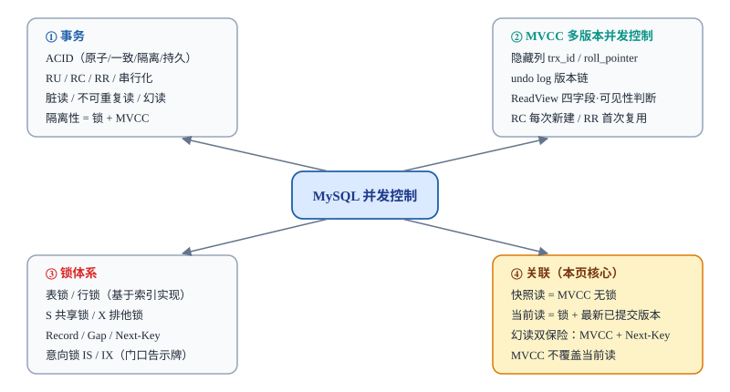
*图 6-1 MySQL 并发控制知识地图：从事务、MVCC、锁体系到两者关联的全景*

> 🎯 📌 **延伸阅读：** 页签七「数据落盘与日志体系：undo / redo / 崩溃恢复」——承接本页 ACID 中的原子性与持久性，讲清数据如何写入磁盘、undo/redo/binlog 如何配合、宕机后怎样崩溃恢复。

### 📌 本页小结

- RR 下两次快照读同一行，别人改完提交，你仍看到旧值——MVCC 靠 ReadView 复用生效。
- FOR UPDATE 在唯一索引等值查询时退化为 Record X 锁，别人 UPDATE 同一行必须等你提交。
- 六条误区：MVCC 不是锁；间隙锁只在 RR；行锁锁在索引上；普通 SELECT 不加 S 锁；InnoDB 默认 RR；当前读幻读靠 Next-Key Lock。
- 知识地图一句话：事务定隔离级别 → MVCC 管快照读 → 锁管当前读 → 两者配合解决幻读。

## 页签七 · 数据落盘与日志体系：undo / redo / 崩溃恢复

*本页回答：修改先写到哪里、日志记什么、提交凭什么算成功、宕机后怎么恢复。承接页签一 ACID（原子性/持久性），呼应页签二 undo 版本链。*

### 7.1 为什么不直接写磁盘

> 🎯 **一句话总结：** 磁盘随机写太慢，所以 InnoDB 先改内存，再顺序写日志，后台异步把脏数据刷回磁盘——用"先改草稿、再归档"的方式平衡性能与安全。

> 💡 **生活化类比：** 桌面草稿纸（内存）比归档柜（磁盘）快得多。你改草稿时不用每次都把纸塞进柜子，而是先在纸上改，等写完了再统一归档。但草稿纸可能被风吹走，所以你每次修改都先抄一份"流水账"（日志）——万一草稿纸被吹走，凭流水账能恢复。

#### 内存（Buffer Pool）

MySQL 启动时向操作系统申请的一块内存，用来缓存数据页和索引页。改数据时直接改这块内存里的页，速度极快。

**脏页：** Buffer Pool 里被改过、还没刷回磁盘的数据页，就叫"脏页"——它和磁盘上的内容不一致了。

#### 磁盘（数据文件）

真正的数据存在磁盘上的 .ibd 文件里，按 16KB 一页组织。磁盘随机写很慢（一次几毫秒），所以不能每次修改都直接写磁盘。

**刷盘：** 后台线程把脏页写回磁盘数据文件，这个过程叫"刷脏页"，由后台异步完成，不阻塞提交。

> 🔑 📌 **核心思路：** 修改先落内存（快），日志顺序写磁盘（快），脏页异步刷回磁盘（不阻塞）。用"日志先行、数据后刷"的方式，既保证性能又保证安全。

### 7.2 内存与磁盘结构地图

> 🎯 **一句话总结：** 内存里有 Buffer Pool（缓存数据页）和 Log Buffer（redo 日志缓冲）；磁盘上有数据文件（.ibd）、redo log 文件、undo log 表空间。三条箭头把它们串起来。

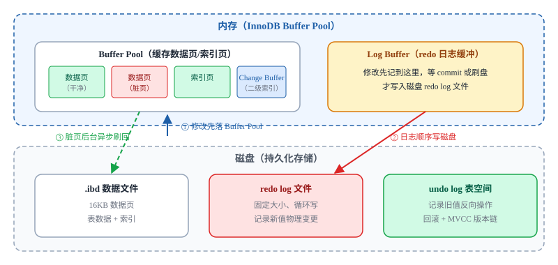
*图 7-1 InnoDB 内存与磁盘结构地图：三条箭头把修改流向串起来*

其中 **Change Buffer** （变更缓冲）是 Buffer Pool 里的一块小区域，用来缓存"非唯一二级索引"的修改，避免每次都去磁盘随机读索引页——一句话带过即可。

### 7.3 一次 UPDATE 的完整分步流程

> 🎯 **一句话总结：** 以 `UPDATE user SET age = 30 WHERE id = 1;`（age 25→30）为例，一次修改要经历"查 Buffer Pool → 写 undo → 改脏页 → 写 redo buffer → prepare → 写 binlog → commit → 后台刷脏页"八个步骤。

1 / 8

*图 7-2 一次 UPDATE 的八步流程节点图*

#### 步骤 1：查 Buffer Pool

先去 Buffer Pool 里找 id=1 这行所在的数据页；如果已经在内存里就直接用，不在就从磁盘 .ibd 文件加载进 Buffer Pool。

这一步是"读"，不写任何日志。

> 🔑 📌 **最关键的一句：** 事务提交成功的标志是 **redo commit 落盘** ，不是数据页刷盘。脏页由后台线程异步刷回磁盘，提交本身不等脏页刷盘。

> ⚠️ **参数备注：** `innodb_flush_log_at_trx_commit=1`（默认）表示每次 commit 都把 redo log 刷盘；设为 0 表示每秒刷一次（宕机丢 1 秒）；设为 2 表示 commit 只写 OS 缓存、操作系统崩溃才丢。生产环境一般用 1。

### 7.4 undo / redo / binlog 分工对照表

> 🎯 **一句话总结：** undo log 记旧值（逻辑日志、回滚用），redo log 记新值（物理日志、宕机恢复用），binlog 记逻辑变更（Server 层、主从复制用）。三者分工不同，缺一不可。

| 日志类型 | 记录内容 | 日志性质 | 写入时机 | 用途 | 生命周期 |
|---|---|---|---|---|---|
| **undo log** | 旧值（修改前的行数据） | 逻辑日志（记录反向操作） | 修改当前行之前 | 事务回滚；MVCC 版本链（页签二） | update undo 提交后由 purge 线程清理；insert undo 提交后即丢弃 |
| **redo log** | 新值物理变更（表空间/页号/偏移/修改后的字节） | 物理日志 | 先写 Log Buffer，commit 时刷盘到 redo log 文件 | 事务持久性；宕机后重放已提交事务 | 固定大小、循环写；checkpoint 覆盖旧日志 |
| **binlog** | 逻辑变更（行/语句格式） | 逻辑日志（Server 层） | 事务 commit 时写入 | 主从复制；备份恢复 | 追加写，不循环；由备份策略清理 |

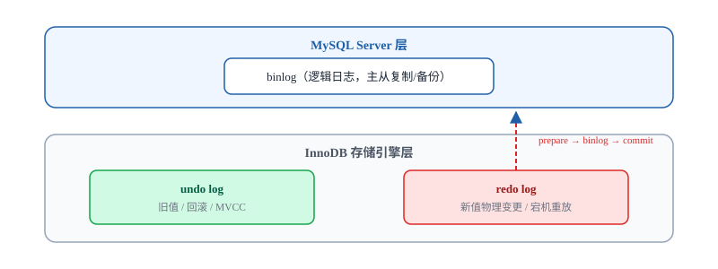
*图 7-3 三日志关系结构图：Server 层 binlog 与 InnoDB 层 undo/redo 分层*

> 🔑 📌 **呼应 ACID（页签一）：** undo log 支撑 **原子性** （回滚），redo log 支撑 **持久性** （宕机后不丢已提交数据），与页签一 1.2 节说法完全一致。

### 7.5 崩溃恢复（crash recovery）三场景

> 🎯 **一句话总结：** MySQL 宕机重启后，会扫描 redo log，把"已提交但脏页没刷盘"的事务重放回去；把"未提交"的事务用 undo log 回滚；两阶段提交缝隙中的事务按 binlog 是否完整决定补提交还是回滚。

#### `场景 A` 事务已提交（redo commit 已落盘），脏页还没刷盘

**宕机前：**redo commit 已落盘、脏页未刷盘 **→** **恢复动作：**扫描 redo log 重放已提交事务 **→** **最终结果：**数据回到提交后状态，不丢失

**宕机前状态：** 事务已 COMMIT，redo log 里有 commit 标记，但脏页还在 Buffer Pool 里没刷回磁盘。

**恢复路径：** 重启后从最后一个 checkpoint 开始扫描 redo log，找到这条已提交事务的记录， **重放** （redo）它的修改——把数据页恢复到提交后的状态。

**结果：** 数据不丢，与宕机前一致。这就是 redo log 支撑持久性的体现。

#### `场景 B` 事务未提交（宕机时还在 prepare 之前或无 commit 记录）

**宕机前：**未 COMMIT、无 commit 记录 **→** **恢复动作：**用 undo log 反向回滚 **→** **最终结果：**回到事务开始前状态，事务撤销

**宕机前状态：** 事务执行到一半，还没 COMMIT；redo log 里没有 commit 标记。

**恢复路径：** 重启后扫描 redo log，发现这条事务没有 commit 记录，于是用 **undo log 反向回滚** ——把修改前的旧值恢复回去，让数据回到事务开始前的状态。

**结果：** 事务被回滚，数据保持一致性。这就是 undo log 支撑原子性的体现。

#### `场景 C` 宕机在 prepare 之后、commit 之前（两阶段提交缝隙）

**宕机前：**prepare 已写、commit 未落盘 **→** **恢复动作：**查 binlog——完整则补提交，不完整则 undo 回滚 **→** **最终结果：**redo 与 binlog 保持一致

**宕机前状态：** redo log 已写 prepare 标记，但 binlog 刚写完或还没写完，redo commit 还没落盘。

**恢复路径：** 重启后扫描 redo log，发现 prepare 记录但没有 commit 标记，于是去查 binlog： **binlog 完整则补提交（redo commit）** ； **binlog 不完整则用 undo 回滚** 。

**结果：** 两阶段提交（prepare → binlog → commit）保证了 redo 与 binlog 一致，不会出现"redo 提交了但 binlog 没写"的主从不一致问题。

> ⚠️ **checkpoint 与 redo 循环写：** redo log 文件大小固定，写满后从开头循环覆盖。checkpoint 记录"已经刷到磁盘的最旧 redo 位置"，重启时从最后一个 checkpoint 开始重放，不用从头扫描。

### 📌 本页小结

- **先改内存、顺序写 redo、后台刷脏页** ：Buffer Pool 缓存数据页，脏页由后台线程异步刷回磁盘，提交不等脏页刷盘。
- **undo 记旧值、redo 记新值** ：undo log 是逻辑日志（回滚 + MVCC），redo log 是物理日志（宕机重放）。
- **提交标志是 redo commit 落盘** ：不是数据页刷盘；commit 走两阶段提交（prepare → binlog → commit）。
- **崩溃恢复 = redo 重放已提交 + undo 回滚未提交** ；两阶段缝隙按 binlog 是否完整决定补提交还是回滚。
- **binlog 是 Server 层逻辑日志** ：主从复制和备份用，与 InnoDB 层 undo/redo 分工不同。

本页承接：
页签一 ACID（原子性靠 undo、持久性靠 redo）→ 页签二 undo 版本链（update undo 生命周期）→ 页签三 当前读（为什么修改前要以当前读加 X 锁）→ 本页把"日志怎么写、宕机怎么恢复"串起来。

---
*本指南基于 MySQL InnoDB 官方实现口径整理，用于学习理解；生产环境请结合官方文档与实际版本验证。*
